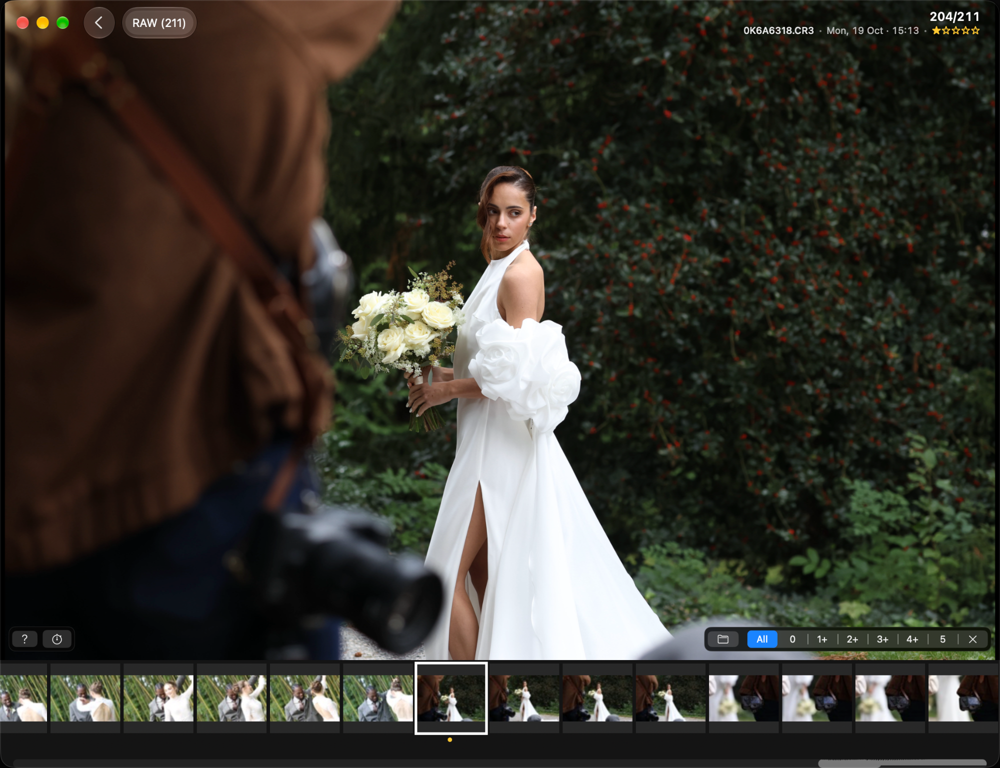

# RAW Viewer

Fast RAW image viewer for photo culling with Lightroom-compatible ratings and DaVinci Resolve integration.



## Install

```sh
brew install --cask yannickpulver/tap/raw-viewer
```

Or grab the latest build from the [Releases](https://github.com/yannickpulver/raw-viewer/releases) page.

## Features

- Load RAW files from folder (recursive) or drag-drop
- Fast preview using embedded JPEGs
- Star ratings (0-5) saved to XMP sidecar files
- Filmstrip navigation
- Pinch-to-zoom, two-finger swipe navigation
- Filter by minimum rating
- Face detection (optional, switched on the start screen; local, Apple Vision): boxes on the photo, face crops with closed-eye markers under the info block, click a face to zoom in
- Sort oldest first, newest first, or by best faces (most sharp, open-eyed faces first)
- Video mode (MOV/MP4 playback)
- All mode: RAW, JPEG and video in one timeline
- Group by scene (optional): frames shot within a minute of each other form a scene, with its own rows in the grid and gaps in the filmstrip
- Duel: two frames of a scene side by side with shared zoom; keep one or both until the scene's best get 2★ (`Cmd+1`, then `V`)
- DaVinci Resolve export with rating metadata
- Auto-updates: new releases are offered in the app and installed with one click

## Development

The released app is the native SwiftUI/AppKit app in [`mac/`](mac/README.md) (macOS 15+). It
follows the behavioural spec in [`docs/spec/`](docs/spec/README.md).

```bash
cd mac
tuist generate --no-open
xcodebuild -project RAWViewer.xcodeproj -scheme RAWViewer -configuration Debug build
```

## Releasing

Bump [`VERSION`](VERSION) and merge to `main`. CI builds, signs and notarizes the app, publishes
the GitHub release `v<VERSION>` and updates the Homebrew cask.

## Legacy Python app

The original PySide6 viewer is still in the repo root but is no longer released.

```bash
pip install -r requirements.txt
python main.py "/path/to/photos"
```

## Shortcuts

| Key | Action |
|-----|--------|
| `←` `→` | Previous / Next image |
| `↑` `↓` | Previous / Next scene (while grouped by scene) |
| `0-5` | Set rating (auto-advances) |
| `Cmd+0-5` | Filter by minimum rating |
| `S` | Jump to first (start) |
| `E` | Jump to last (end) |
| `Shift+R` | Jump to last rated |
| `Shift+S` | Group by scene |
| `V` | Duel: `←` / `→` keeps one, `↓` both, `Cmd+Z` undoes |
| `R` | Rotate image 90° (view only) |
| `I` | Toggle info overlay |
| `F` | Show / hide faces (needs face detection on) |
| `H` | Toggle help overlay |
| `J` | Toggle JPEG mode |
| `M` | Toggle Video mode |
| `A` | Toggle All mode |
| `Space` | Play/Pause video |
| `O` | Reveal in Finder |
| `Cmd+L` | Open in Lightroom |
| `Cmd+D` | Export to DaVinci Resolve |
| `Cmd+S` | Toggle filmstrip |
| `Esc` | Close folder |
| `Cmd+Q` / `Cmd+W` | Quit |

Pinch to zoom, drag to pan, two-finger swipe to navigate. Scroll wheel on filmstrip.

## DaVinci Resolve Export

Press `Cmd+D` to export all visible files (respecting current filter) to DaVinci Resolve. Creates a project, imports media, and maps star ratings to clip colors:

| Rating | Clip Color | Keywords |
|--------|-----------|----------|
| 1★ | Blue | `1star` |
| 2★ | Teal | `2stars` |
| 3★ | Yellow | `3stars` |
| 4★ | Orange | `4stars` |
| 5★ | Green | `5stars,keeper` |

4-5★ clips are also marked as "Good Take". Requires **DaVinci Resolve Studio** (scripting API not available in free version).
